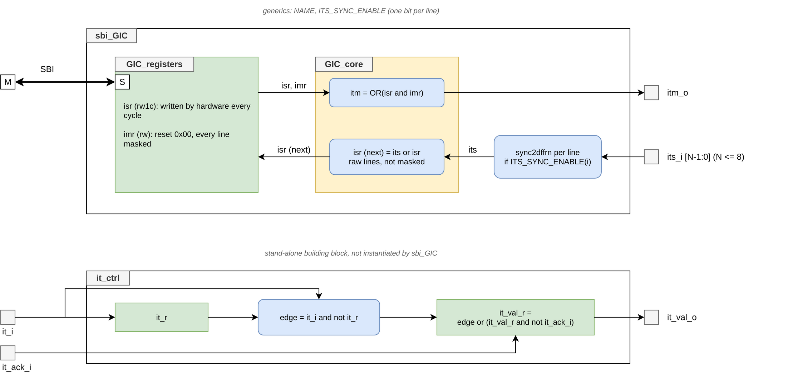
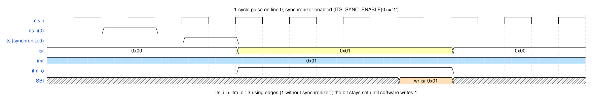

<!--
  README MODEL (common to every Asylum IP, keep the same headings)
  ----------------------------------------------------------------
  Regenerate from the sources, never from the previous README text alone:
    hdl/*.vhd (entities, generics, ports), hdl/csr/*.hjson (register map),
    <IP>.core (VLNV, targets, depends), mk/targets.txt, sim/, syn/, esw/.
  Sections, in this order:
    badges / title + one-line pitch / Overview / Features / Block Diagram /
    Getting Started / Hardware Interfaces / Configuration / Resources /
    Theory of Operation / Registers / Programmer's Guide /
    Design Verification / Dependencies and Related IPs / License
  Rules:
    - English, short and factual: every statement backed by the sources.
    - No VLNV line: the version badge shows it.
    - Badges: first line version, license; second line CI, lint, sim, syn.
    - Block diagram and FSM: pages Overview and FSM of doc/<NAME>.drawio, exported to
      doc/<NAME>-Overview.png and doc/<NAME>-FSM.png (make -C doc).
    - Timing diagrams: WaveDrom source doc/<NAME>-<what>.json, rendered
      doc/<NAME>-<what>.svg (make -C doc), shown as images.
    - No CPU named (OpenBlaze, PicoBlaze, RISC-V) outside the CPU and SoC IPs.
    - Registers: link to the generated hdl/csr/<X>_csr.md, never copy the tables.
    - Tables: Configuration = Name|Type|Default|Description,
      Hardware Interfaces = Name|Direction|Type|Description, grouped by interface.
    - A section with nothing to say is one line ("This IP has no
      software-visible registers."), never removed.
-->
[](https://github.com/deuskane/asylum-system-gic/tags)
[](LICENSE)

[](https://github.com/deuskane/asylum-system-gic/actions/workflows/ci.yml)
[](https://github.com/deuskane/asylum-system-gic/actions/workflows/ci.yml)
[](https://github.com/deuskane/asylum-system-gic/actions/workflows/ci.yml)
[](https://github.com/deuskane/asylum-system-gic/actions/workflows/ci.yml)

# GIC interrupt controller

**A small interrupt controller in VHDL: up to 8 interrupt lines latched in a status register, a mask register and one merged interrupt output, on the SBI bus.**

Part of the [Asylum project](https://github.com/deuskane/asylum-project), a collection of small IP cores, written to be read and learned from.

## Table of Contents

1. [Overview](#overview)
2. [Features](#features)
3. [Block Diagram](#block-diagram)
4. [Getting Started](#getting-started)
5. [Hardware Interfaces](#hardware-interfaces)
6. [Configuration](#configuration)
7. [Resources](#resources)
8. [Theory of Operation](#theory-of-operation)
9. [Registers](#registers)
10. [Programmer's Guide](#programmers-guide)
11. [Design Verification](#design-verification)
12. [Dependencies and Related IPs](#dependencies-and-related-ips)
13. [License](#license)

## Overview

A CPU has one interrupt input, a system has several interrupt sources. The GIC (General Interrupt Controller) of Asylum merges up to 8 interrupt lines into one:

- every line is latched in the interrupt status register `isr`, masked or not,
- the interrupt mask register `imr` selects the lines that raise the merged output `itm_o`,
- software reads `isr` to find the pending lines and clears the served ones by writing 1 (rw1c).

Each line can go through a 2-flip-flop synchronizer when its source is asynchronous to the clock. The combinational part, `GIC_core`, is also used by other Asylum IPs to build their own interrupt registers.

## Features

- 1 to 8 interrupt lines, active high, level-sensitive
- Sticky status register `isr` (write 1 to clear), updated every cycle with the raw lines: masked lines are latched too (polling, no event lost while masked)
- Mask register `imr`, reset to 0x00 (every line masked); it only masks `itm_o`
- Merged interrupt output `itm_o` = OR of the pending and unmasked lines, registered (no combinational path from `its_i`)
- Optional 2-flip-flop synchronizer per line (`ITS_SYNC_ENABLE`)
- Two 8-bit registers, one address bit
- Reusable `GIC_core` (status update and merge, no register) and a stand-alone edge latch with acknowledge, `it_ctrl`

## Block Diagram



## Getting Started

The cores of the Asylum IPs are published in the FuseSoC library [asylum-cores](https://github.com/deuskane/asylum-cores) (with the UVVM core used by the testbenches):

```bash
pip install fusesoc
fusesoc library add https://github.com/deuskane/asylum-cores
fusesoc run --target sim_gic_8_sync_mask_pending asylum:system:GIC  # needs GHDL
```

To use the IP in your design, add `asylum:system:GIC` to the `depend` list of your core and instantiate `sbi_GIC` (library `asylum`):

```vhdl
library asylum;
use     asylum.sbi_pkg.all;
use     asylum.GIC_pkg.all;

  -- its : std_logic_vector(3 downto 0) : the interrupt sources

  ins_gic : sbi_GIC
    generic map
    ( NAME            => "GIC0"
     ,ITS_SYNC_ENABLE => "1100"      -- synchronizer on lines 3 and 2 (asynchronous sources)
    )
    port map
    ( clk_i     => clk
     ,arst_b_i  => arst_b
     ,sbi_ini_i => sbi_ini           -- 1 address bit, 8-bit data
     ,sbi_tgt_o => sbi_tgt
     ,its_i     => its
     ,itm_o     => cpu_irq
    );
```

[PicoSoC](https://github.com/deuskane/asylum-soc-picosoc) is a complete example: its user and supervisor subsystems each merge their interrupt sources with an `sbi_GIC`.

## Hardware Interfaces

Top-level entity: **`sbi_GIC`** ([hdl/sbi_GIC.vhd](hdl/sbi_GIC.vhd)), component in `asylum.GIC_pkg`.

### Clock and Reset

| Name | Direction | Type | Description |
|------|-----------|------|-------------|
| `clk_i` | in | std_logic | System clock, the only clock of the IP |
| `arst_b_i` | in | std_logic | Asynchronous reset, active low |

### Bus (SBI)

| Name | Direction | Type | Description |
|------|-----------|------|-------------|
| `sbi_ini_i` | in | sbi_ini_t | Request from the initiator (`cs`, `re`, `we`, `addr`, `wdata`); 1 address bit, 8-bit data |
| `sbi_tgt_o` | out | sbi_tgt_t | Response to the initiator (`ready`, `rdata`, `info`); no wait state |

### Interrupts

| Name | Direction | Type | Description |
|------|-----------|------|-------------|
| `its_i` | in | std_logic_vector (unconstrained) | Interrupt lines, active high, at most 8 (assertion). Mapped by position, whatever the range and the direction: the rightmost element is line 0 = `isr` bit 0 (`its_i(i)` is line i for a `(N-1 downto 0)` vector) |
| `itm_o` | out | std_logic | Merged interrupt: OR of the `isr` bits enabled in `imr` |

<details>
<summary><b>GIC_core</b>: status update and merge, without registers, for the interrupt registers of another IP</summary>

[hdl/GIC_core.vhd](hdl/GIC_core.vhd), component in `asylum.GIC_pkg`. No generic. Used by the UART, the GPIO with interrupts and the timer of Asylum.

| Name | Direction | Type | Description |
|------|-----------|------|-------------|
| `its_i` | in | std_logic_vector (unconstrained) | Interrupt sources, mapped by position (rightmost element = bit 0), at most `isr_i'length` (assertion) |
| `isr_i` | in | std_logic_vector (unconstrained) | Current value of the status register |
| `isr_o` | out | std_logic_vector (unconstrained) | Next value of the status register: `its or isr_i` (raw lines, not masked) |
| `imr_i` | in | std_logic_vector (unconstrained) | Current value of the mask register |
| `itm_o` | out | std_logic | `OR(isr_i and imr_i)` |

</details>

<details>
<summary><b>it_ctrl</b>: rising-edge latch with acknowledge, one line (not used by sbi_GIC)</summary>

[hdl/it_ctrl.vhd](hdl/it_ctrl.vhd), component in `asylum.GIC_pkg`. No generic.

| Name | Direction | Type | Description |
|------|-----------|------|-------------|
| `clk_i` | in | std_logic | System clock |
| `arstn_i` | in | std_logic | Asynchronous reset, active low |
| `it_i` | in | std_logic | Interrupt line, synchronous to `clk_i` |
| `it_val_o` | out | std_logic | Set on a rising edge of `it_i`, held until acknowledged (register output) |
| `it_ack_i` | in | std_logic | Clears `it_val_o`; a new edge in the same cycle wins (`it_val_o` stays set, the edge is not lost) |

</details>

## Configuration

Generics of `sbi_GIC`:

| Name | Type | Default | Description |
|------|------|---------|-------------|
| `NAME` | string | `""` | Instance name, visible in `sbi_tgt_o.info` |
| `ITS_SYNC_ENABLE` | std_logic_vector | *(none)* | One bit per line, same length as `its_i` (assertion), mapped by position like `its_i` (rightmost element = line 0): `'1'` inserts a `sync2dffrn` synchronizer (2 flip-flops, 2 more cycles of latency) on the line, `'0'` uses the line as is (it must then be synchronous to `clk_i`) |

The number of lines is the length of `its_i`.

## Resources

Figures of the `syn_*` targets (`make nonreg_syn`, see [Targets](#targets)): [syn/sbi_GIC_wrapper.vhd](syn/sbi_GIC_wrapper.vhd) (`sbi_GIC` with flat SBI ports) with the generics of each configuration, and `it_ctrl` alone, synthesized by Yosys and its GHDL plugin; the reports are in the build directory of each target.

| Configuration | LUT¹ | LUTRAM¹ | FF¹ | CARRY4¹ | MUXF7/F8¹ | BRAM¹ | DSP¹ | Area² (µm²) | kGE³ |
|---|---|---|---|---|---|---|---|---|---|
| `syn_default` (8 lines, no synchronizer) | 21 | 0 | 16 | 0 | 3 | 0 | 0 | 700.67 | 0.187 |
| `syn_sync8` (8 lines, synchronizer on every line) | 21 | 0 | 32 | 0 | 3 | 0 | 0 | 1101.06 | 0.293 |
| `syn_mixed3` (3 lines, synchronizer on lines 0 and 2) | 21 | 0 | 20 | 0 | 3 | 0 | 0 | 794.51 | 0.212 |
| `syn_sync1` (1 line with synchronizer) | 21 | 0 | 18 | 0 | 3 | 0 | 0 | 741.96 | 0.198 |
| `syn_it_ctrl` (`it_ctrl` alone) | 2 | 0 | 2 | 0 | 0 | 0 | 0 | 63.81 | 0.017 |

¹ Xilinx Artix-7 (LUT6), Yosys 0.33 `synth_xilinx -flatten -noiopad -noclkbuf`, before place and route: every cell of the netlist is counted, Vivado may differ. Identical cells are merged as a vendor tool does (`opt_merge -share_all`): the inverters of an active-low reset net become one; every remaining cell is counted, an `INV` as a `LUT1` (1 of the 21 LUTs of every `sbi_GIC` configuration: the synchronizers add flip-flops only). The IP has no memory: no LUTRAM, no BRAM. Flip-flops: `isr` and `imr` (8 each, whatever the number of lines) and 2 per synchronized line.

² SkyWater sky130 `sky130_fd_sc_hd`, typical corner (tt, 25 °C, 1.80 V), Yosys 0.33 `synth` + `dfflibmap` + `abc -liberty`: standard-cell area only, no timing constraint, no buffering, clock tree or placement.

³ Area in thousands of NAND2 gate equivalents (`sky130_fd_sc_hd__nand2_1` = 3.7536 µm²).

## Theory of Operation

### Hierarchy

| File | Unit | Role |
|------|------|------|
| [hdl/sbi_GIC.vhd](hdl/sbi_GIC.vhd) | `sbi_GIC` | Top level: synchronizers, registers, `GIC_core` |
| [hdl/GIC_core.vhd](hdl/GIC_core.vhd) | `GIC_core` | Next value of `isr` and merged interrupt, combinational |
| [hdl/it_ctrl.vhd](hdl/it_ctrl.vhd) | `it_ctrl` | Rising-edge latch with acknowledge, stand-alone |
| [hdl/GIC_pkg.vhd](hdl/GIC_pkg.vhd) | `GIC_pkg` | Components, records `it_ini_t` / `it_tgt_t` and their arrays |
| `hdl/csr/GIC_csr.vhd` | `GIC_registers` | Register bank, generated by regtool from [hdl/csr/GIC.hjson](hdl/csr/GIC.hjson) |

### Interrupt flow

- `isr_next = its or isr`, written by the hardware every cycle: every line is latched, masked or not, and a bit stays set until software writes 1 to it. Software can poll `isr` with the lines masked, and an event that occurs while its line is masked is not lost.
- `itm_o = OR(isr and imr)`: the output follows the registered `isr`, one cycle after the line (three with the synchronizer), so a 1-cycle pulse is enough. Masking a pending line drops `itm_o` (critical section), unmasking it raises `itm_o` again: clear the pending bits to ignore before unmasking a line.
- The lines are level-sensitive: a bit cleared while its line is still active is set again on the next cycle. Clear the source first, then the `isr` bit.
- Lines without synchronizer (`ITS_SYNC_ENABLE(i) = '0'`) must already be synchronous to `clk_i`.



### Write 1 to clear and new events

In the cycle of a software write of `isr`, the software clear has priority over a new event on the same bit (`rw1c` model of `csr_reg`, as the W1C registers of OpenTitan and the default `precedence = sw` of SystemRDL). Write 1 only to the bits whose event has been handled, typically the bits read and served: an event on a bit already set merges with the one being acknowledged (as any event between the read of `isr` and the write), while a write of 1 to a bit still at 0 can clear an event that the software has not seen yet. A constant mask (0xFF) is safe only when the handler has served every source and holds them inactive during the write.

### it_ctrl

`it_ctrl` registers `it_i`, sets `it_val_o` on a rising edge (`it_i and not it_r`) and clears it on `it_ack_i`: `it_val_next = edge or (it_val and not it_ack)`, so an edge that coincides with the acknowledge is kept. It is a building block declared in `GIC_pkg`; `sbi_GIC` does not use it.

## Registers

Two 8-bit registers (1 address bit): `isr` (0x0, rw1c, bit i = line i) and `imr` (0x1, rw, reset 0x00).

- Register documentation: **[hdl/csr/GIC_csr.md](hdl/csr/GIC_csr.md)**
- C header: [hdl/csr/GIC_csr.h](hdl/csr/GIC_csr.h)
- Source: [hdl/csr/GIC.hjson](hdl/csr/GIC.hjson) (regtool)

The bits of `isr` and `imr` above the number of lines exist (8-bit registers) but `isr` never sets them.

## Programmer's Guide

### Initialization

1. Write 0xFF to `isr` to drop the events latched since the reset (a line still active sets its bit again).
2. Write `imr` with the lines to enable.

### Interrupt handler

1. Read `isr` and `imr`: the pending lines are `isr & imr` (the masked lines can be polled in `isr`).
2. For each pending line: serve and deactivate its source, then write 1 to its bit of `isr` (and only to the bits served, see [Write 1 to clear and new events](#write-1-to-clear-and-new-events)).
3. `itm_o` falls when no unmasked bit is set.

To enable or disable one line, read-modify-write `imr`.

### Example

The registers are 8 bits wide, at consecutive byte addresses from the base address of the IP (`0x40000000` is an example, use the address map of your SoC).

```c
#include <stdint.h>
#include "GIC_csr.h"

#define GIC_BASE ((uintptr_t)0x40000000u)   // example base address

static inline void reg_wr(uint32_t offset, uint8_t data)
{
  *(volatile uint8_t *)(GIC_BASE + offset) = data;
}

static inline uint8_t reg_rd(uint32_t offset)
{
  return *(volatile uint8_t *)(GIC_BASE + offset);
}

void gic_init(uint8_t lines)
{
  reg_wr(GIC_ISR, 0xFF);                       // drop the events latched before
  reg_wr(GIC_IMR, lines);                      // unmask the used lines
}

// Called when itm_o is high
void gic_handler(void (*serve[8])(void))
{
  uint8_t pending = reg_rd(GIC_ISR) & reg_rd(GIC_IMR);

  for (int i = 0; i < 8; i++)
    if (pending & (1u << i)) {
      serve[i]();                              // clear the source first (level)
      reg_wr(GIC_ISR, 1u << i);                // then acknowledge this bit only
    }
}

void gic_mask(uint8_t line)
{
  // read-modify-write: the other lines keep their mask
  reg_wr(GIC_IMR, reg_rd(GIC_IMR) & ~(1u << line));
}
```

## Design Verification

### Testbenches

| File | DUT | Description |
|------|-----|-------------|
| [sim/gic/tb_GIC.vhd](sim/gic/tb_GIC.vhd) | `sbi_GIC` | Self-checking UVVM testbench with the SBI BFM (every access checked without wait state), generics `TESTS_LIST` (scenarios, see below), `NB_LINES` (1 to 8) and `SYNC_MASK` (`ITS_SYNC_ENABLE`, bit i = line i). The DUT is connected with an `its_i(NB_LINES downto 1)` vector and an ascending `ITS_SYNC_ENABLE(0 to NB_LINES-1)` to check the mapping by position; the `isr` bits above `NB_LINES` are checked to stay 0. Scenarios in `tb_GIC_<name>_pkg` (procedure `run`), names and dispatch in [tb_GIC_tests_pkg](sim/gic/tb_GIC_tests_pkg.vhd), helpers (register accesses and checks, interrupt lines, reset pulse) in [tb_GIC_bfm_pkg](sim/gic/tb_GIC_bfm_pkg.vhd) |
| [sim/it_ctrl/tb_it_ctrl.vhd](sim/it_ctrl/tb_it_ctrl.vhd) | `it_ctrl` | Self-checking UVVM testbench, generic `TESTS_LIST`; scenarios, names and dispatch in [tb_it_ctrl_pkg](sim/it_ctrl/tb_it_ctrl_pkg.vhd) |

### Scenarios (`TESTS_LIST`)

The scenarios are chosen at run time with the generic `TESTS_LIST`: names separated by `,` without space (`rw1c,random,rw1c`), a name may be repeated. The sequencer first checks every name (an unknown name is a `TB_ERROR` before any scenario runs), then for each scenario drives a reset pulse with the bus and the lines inactive, logs `TEST <i>/<N> : <name>` and runs it: each scenario starts from reset and builds its own context. The empty list (default) only compiles and elaborates the testbench. The list is parsed and its names checked with `list_length` / `list_item` / `list_contains` of `asylum.string_pkg` (`asylum:utils:pkg` >= 1.10.0).

`tb_GIC` (checks counted as the `=> OK` lines of the log, reference configuration: 8 lines with a synchronizer on every line; N = `NB_LINES`):

| Name | Checks | Description |
|------|--------|-------------|
| `reset_values` | 3 | `isr` = `imr` = 0 (every line masked) and `itm_o` = 0 after reset |
| `imr_rw` | 6 | `imr` read / write with the lines inactive, `isr` stays 0 |
| `masked_latched` | 3 | Every line masked: the active lines are latched in `isr`, `itm_o` stays 0 |
| `unmasked_itm` | 48 (6 × N) | For each line, unmasked alone with every line active: every line is latched, only the unmasked one raises `itm_o`, the bits stay set after the lines fall, clearing the unmasked bit drops `itm_o` while the masked bits stay pending |
| `latency_pulse` | 24 (3 × N) | For each line: latency `its_i` -> `itm_o` (1 cycle without synchronizer, 3 with it) and capture of a 1-cycle pulse |
| `rw1c` | 6 | `isr` rw1c: a write of 0 has no effect, 0x55 / 0xAA clear the even / odd bits, `itm_o` = OR(`isr`) |
| `isr_set_again` | 32 (4 × N) | For each line: a bit cleared while its line is active reads 0 during one cycle and is set again |
| `mask_pending` | 11 | Masking pending lines drops `itm_o` without clearing them, unmasking raises it again; masked active lines and masked 1-cycle pulses are latched, unmasking them raises `itm_o` (no event lost) |
| `random` | 96 | 32 random `imr` / line patterns checked against `isr = OR(its)` and `itm_o = OR(isr and imr)`, with random clears |
| `async_reset` | 4 | Every line latched and unmasked, then a reset pulse: `isr`, `imr` and `itm_o` back to 0 |

`tb_it_ctrl`:

| Name | Checks | Description |
|------|--------|-------------|
| `edge` | 9 | `it_val_o` is a register output (still 0 before the clock edge); a rising edge is latched until the acknowledge, a level that stays high is not latched again, a new edge is |
| `edge_ack` | 3 | A rising edge in the cycle of the acknowledge is kept |

The testbenches were validated with 20 RTL mutants (scratch copies, each scenario run alone): every mutant is killed by at least one scenario. The mapping of `ITS_SYNC_ENABLE` by position is only checked by the asymmetric configuration `sim_gic_4_mixed`.

### Targets

| Target | Toplevel | Description |
|--------|----------|-------------|
| `default` | `sbi_GIC` | HDL fileset + CSR generation (not a simulation) |
| `sim_gic_8_sync` | `tb_GIC` | Reference configuration, 8 lines with a synchronizer on every line: build and elaboration only (`TESTS_LIST` empty), base of the scenario targets and of the list runs |
| `sim_gic_8_sync_<name>` | `tb_GIC` | One target per scenario: `sim_gic_8_sync_reset_values`, `_imr_rw`, `_masked_latched`, `_unmasked_itm`, `_latency_pulse`, `_rw1c`, `_isr_set_again`, `_mask_pending`, `_random`, `_async_reset` (233 checks in all) |
| `sim_gic_8_nosync` | `tb_GIC` | 8 lines, no synchronizer, every scenario (233 checks) |
| `sim_gic_3_mixed` | `tb_GIC` | 3 lines, synchronizer on lines 0 and 2, every scenario (168 checks) |
| `sim_gic_4_mixed` | `tb_GIC` | 4 lines, synchronizer on lines 0 and 1, every scenario (181 checks; asymmetric: a reversed mapping of `ITS_SYNC_ENABLE` changes the latencies) |
| `sim_gic_1_sync` | `tb_GIC` | 1 line with synchronizer, every scenario (142 checks) |
| `sim_it_ctrl` | `tb_it_ctrl` | Build and elaboration only (`TESTS_LIST` empty) |
| `sim_it_ctrl_<name>` | `tb_it_ctrl` | One target per scenario: `sim_it_ctrl_edge`, `sim_it_ctrl_edge_ack` (12 checks in all) |
| `lint_ghdl` | `asylum.sbi_GIC_wrapper` | GHDL `-Wall` analysis of the sources and elaboration of [syn/sbi_GIC_wrapper.vhd](syn/sbi_GIC_wrapper.vhd) (`sbi_GIC` with flat SBI ports) |
| `lint_ghdl_synth_<config>` | `asylum.sbi_GIC_wrapper` | `ghdl --synth` check (no latch, synthesizable) of 4 configurations: `default` (8 lines, no synchronizer), `sync8` (8 lines with synchronizer), `mixed3` (3 lines, `ITS_SYNC_ENABLE = 101`), `sync1` (1 line with synchronizer) |
| `lint_ghdl_synth_it_ctrl` | `asylum.it_ctrl` | `ghdl --synth` check of `it_ctrl` |
| `syn_<config>` | `asylum.sbi_GIC_wrapper`, `asylum.it_ctrl` | Synthesis with Yosys, Artix-7 and sky130 (see [Resources](#resources)), same configurations as `lint_ghdl_synth_*`: `syn_default`, `syn_sync8`, `syn_mixed3`, `syn_sync1`, `syn_it_ctrl` |

The reference configuration of a testbench has a build-only base target and one target per scenario: one CI job per scenario, a failure is isolated. Every other configuration has one target that runs its whole list: the `TEST <i>/<N>` header names a failing scenario. FuseSoC replaces the `parameters` list of an inherited target, so each target repeats the generics of its configuration.

Every `sim_*`, `lint_*` and `syn_*` target is a job of the [GitHub CI](https://github.com/deuskane/asylum-system-gic/actions/workflows/ci.yml), run in the [asylum-env](https://github.com/deuskane/asylum-ci) image (GHDL, FuseSoC, UVVM, Yosys). The `sim`, `lint` and `syn` badges count the passed and failed targets of the last run on `main`.

### How to Run

From a clone of [asylum-project](https://github.com/deuskane/asylum-project) (GHDL and FuseSoC installed, or in the asylum-env image):

```bash
make help                        # variables, rules and targets
make sim_gic_8_sync_rw1c         # one scenario, log in log/
make sim_gic_3_mixed             # every scenario of a configuration
make nonreg_sim                  # every sim_* target
make nonreg_lint                 # every lint_* target
make nonreg_syn                  # every syn_* target (Yosys, figures of Resources)
make TARGETS_FILTER=^sim_it_ctrl nonreg_sim
```

To run a list of scenarios, build the testbench once, then run the list without recompiling, either with FuseSoC (same `--build-root` and `--no-export` as the Makefile, so that the build of the target is reused; any generic of the target can be overridden after the VLNV):

```bash
make sim_gic_8_sync              # build and elaboration (TESTS_LIST empty)
fusesoc --cores-root . run --build-root build --no-export --run --target sim_gic_8_sync asylum:system:GIC:2.0.0 --TESTS_LIST=rw1c,random,rw1c
make sim_it_ctrl
fusesoc --cores-root . run --build-root build --no-export --run --target sim_it_ctrl asylum:system:GIC:2.0.0 --TESTS_LIST=edge_ack,edge
```

or in the build directory of the target. `EXTRA_OPTIONS` replaces every generic set by the target: repeat the generics of the configuration, else their default values apply (`SYNC_MASK=0`):

```bash
cd build/asylum_system_GIC_2.0.0/sim_gic_8_sync-ghdl
make run EXTRA_OPTIONS="-gTESTS_LIST=rw1c,random,rw1c -gNB_LINES=8 -gSYNC_MASK=255"
```

To add a scenario: its package `sim/gic/tb_GIC_<name>_pkg.vhd` with a `run` procedure in the `sim` fileset, its name in `C_TESTS` and its case in `run_test` of [tb_GIC_tests_pkg](sim/gic/tb_GIC_tests_pkg.vhd), a `sim_gic_8_sync_<name>` target and the name in the `TESTS_LIST` of the other configurations in [GIC.core](GIC.core), then `make mk/targets.txt` and `make ci_generate`.

Outside the CI, GHDL writes a waveform `dut.fst`.

## Dependencies and Related IPs

| Core | Repository | Purpose |
|------|------------|---------|
| `asylum:utils:generators` (>= 2.8.0) | [asylum-utils-generators](https://github.com/deuskane/asylum-utils-generators) | regtool (register generator) and the CSR building blocks (`csr_reg`) |
| `asylum:utils:pkg` | [asylum-utils-pkg](https://github.com/deuskane/asylum-utils-pkg) | Common packages (`sbi_pkg`, `logic_pkg` for `reduce_or`, ...); the testbenches need >= 1.10.0 (`string_pkg` lists of `TESTS_LIST`) |
| `asylum:target:techmap` | [asylum-target-techmap](https://github.com/deuskane/asylum-target-techmap) | `sync2dffrn` synchronizer |
| `asylum:utils:ghdl_synth` | [asylum-utils-generators](https://github.com/deuskane/asylum-utils-generators) | `ghdl --synth` check of the `lint_ghdl_synth_*` targets |
| `asylum:utils:yosys_synth` | [asylum-utils-generators](https://github.com/deuskane/asylum-utils-generators) | Yosys synthesis of the `syn_*` targets (Artix-7 and sky130) |
| `bitvis:verification:uvvm` | [UVVM](https://github.com/UVVM/UVVM) | Verification library and SBI BFM |

`sbi_GIC` is used by [asylum-soc-picosoc](https://github.com/deuskane/asylum-soc-picosoc); `GIC_core` by [UART](https://github.com/deuskane/asylum-communication-uart), [GPIO](https://github.com/deuskane/asylum-component-gpio) and [timer](https://github.com/deuskane/asylum-component-timer). All the IPs: [asylum-project](https://github.com/deuskane/asylum-project).

## License

Apache License 2.0, see [LICENSE](LICENSE).
